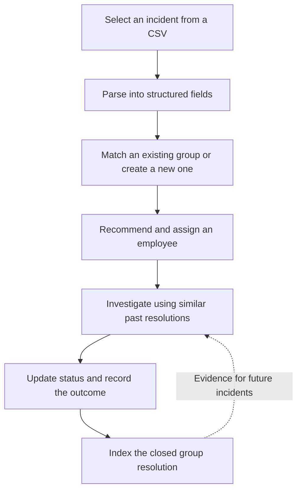

# TechM EquipWise - AI Incident Management

TechM EquipWise uses Azure AI Foundry agents to turn incoming incident reports into grouped, assigned work. Engineers can review related incidents, ask for troubleshooting guidance based on past resolutions, and update a group's status through a Streamlit interface.

## Core implementation idea

The application combines **AI interpretation with explicit backend operations**. Agents interpret incident descriptions, decide whether issues are related, and coordinate workflows. An MCP (Model Context Protocol) server gives those agents named tools for reading data, recording assignments, changing statuses, and retrieving historical resolutions.

PostgreSQL remains the source of truth for incidents and ownership. Business operations are implemented in Python tools with parameterized database queries, so agents work through defined operations rather than generating arbitrary SQL.

The main unit of work is an **incident group**: related incidents share an owner and move through the lifecycle together. A closed group's resolution becomes evidence that can help resolve future incidents.

## How it works



### 1. Parse the incoming incident

The user uploads a CSV and selects one row. The intake page lets them review or edit the descriptions, then sends the row to a Foundry workflow. The parser extracts fields such as incident number, hardware, software, issue, source, severity, and timestamp.

The UI supplies the current timestamp for processing. If the workflow returns only parsed fields, the page attempts a separate call to the grouping agent.

### 2. Group related incidents

Candidate groups are first narrowed down using matching hardware and software systems. Closed and cancelled groups are excluded. The grouping flow then classifies whether the new issue belongs with the issues already in a candidate group.

If a suitable group exists, the incident joins it. Otherwise, it receives a new group ID. This combines structured filtering with interpretation of the incident description.

### 3. Assign an employee

The employee recommendation tool finds people whose software skills match the incident. It ranks them by:

1. Higher skill maturity.
2. Lower current workload.
3. Employee ID as a stable tie-breaker.

The tool returns the best candidate and up to three recommendations. Assignment is recorded as an event in PostgreSQL. Groups in `Assigned`, `WIP`, or `Pause` count toward active workload.

### 4. Investigate using previous resolutions

On the Action page, an engineer selects an employee and an assigned group, then asks for diagnostic guidance or a next action. The Foundry action workflow can retrieve similar closed cases through MCP.

The search implementation combines text and vector retrieval in Azure AI Search, then checks candidate similarity against the current incident context. Matches below a cosine similarity of `0.60` are discarded. The returned cases include their resolution comments, giving the agent historical evidence for its response.

### 5. Record progress and reuse the outcome

The Status Change page sends requests such as `WIP`, `Pause`, `Close`, `Cancel`, or `Re-assign` to the lifecycle workflow. Backend tools update the group's incidents and append assignment events, preserving a timeline of ownership and progress.

Current ownership is derived from the latest event for each group. Reassignment records the transfer from the previous employee to the new employee.

When a group is closed through the status tool, the backend attempts to index its issues and resolution comment in Azure AI Search. This creates a feedback loop: completed work becomes searchable evidence for the next incident. Database closure succeeds independently of indexing; failed indexing can be retried.

## How the components fit together

| Component | Responsibility |
| --- | --- |
| **Streamlit UI** | Incident selection, group review, troubleshooting chat, and status forms |
| **Azure AI Foundry** | Incident interpretation and workflow coordination through deployed agents |
| **MCP server** | Defined tools for database operations, employee recommendations, and resolution search |
| **PostgreSQL** | Persistent incidents, employee skills, assignment history, and lifecycle state |
| **Azure AI Search + embeddings** | Retrieval of similar closed incidents and their resolutions |

The UI reads group and employee data directly from PostgreSQL. Requests that need agent reasoning go to Foundry, whose agents must be configured to use the MCP server.

## Where the core logic lives

- [main.py](main.py) and [Views/](Views/): application navigation and the four user workflows.
- [Agent/AzureAIInterface.py](Agent/AzureAIInterface.py): Foundry authentication, agent invocation, and response handling.
- [MCP/server.py](MCP/server.py): database tools, employee ranking, lifecycle updates, resolution indexing, and similarity search.
- [MCP/client.py](MCP/client.py): an optional local implementation of grouping and assignment using an Azure OpenAI classifier.
- [Postgres/postgres_client.py](Postgres/postgres_client.py): read queries for the UI and assignment timelines.
- [Postgres/schema_extensions.sql](Postgres/schema_extensions.sql): assignment-event table, indexes, and latest-assignment view.

## Running locally

Install dependencies in a virtual environment and create your local configuration file if it does not already exist:

```powershell
python -m venv .venv
.\.venv\Scripts\Activate.ps1
python -m pip install -r requirements.txt
if (!(Test-Path .env)) { Copy-Item .env.example .env }
```

Fill in `.env` with your PostgreSQL and Foundry settings. Resolution search also requires `AZURE_SEARCH_ENDPOINT`, `AZURE_SEARCH_API_KEY`, `AZURE_SEARCH_INDEX_NAME`, `EMBEDDING_ENDPOINT`, `EMBEDDING_API_KEY`, and `EMBEDDING_DEPLOYMENT_NAME`; these keys are read by the server but are not currently in `.env.example`.

Set usable values for the settings you use, or remove unused blank entries when relying on code defaults. Keep `.env` private; `.env.example` is the shareable configuration template.

Start the MCP server:

```powershell
python -m MCP.server
```

In a second terminal, activate the virtual environment and start the UI:

```powershell
.\.venv\Scripts\Activate.ps1
python -m streamlit run main.py
```

This repository assumes that the Foundry workflows, PostgreSQL objects, and search index are provisioned separately. Foundry must be able to reach the MCP endpoint. The resolution index must support 1,536-dimensional vectors and the `recentClosedBoost` scoring profile referenced by the server.

Run the existing helper unit tests with:

```powershell
python -m unittest discover -s tests -p test_workflow.py
```
